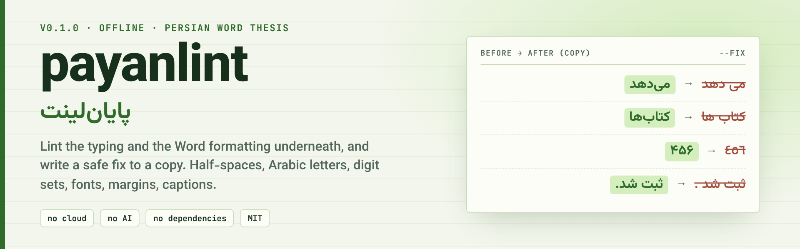

<div align="center">

<picture>
  <source media="(prefers-color-scheme: dark)" srcset="assets/banner-dark.png">
  
</picture>

**English** · [فارسی](README.fa.md) · [🌐 Live site](https://mrzroot.github.io/payanlint/) · [📦 Release v0.1.0](https://github.com/mrzroot/payanlint/releases/tag/v0.1.0) · [🗒 Changelog](CHANGELOG.md)

     

</div>

> **payanlint** (پایان‌لینت, from *پایان‌نامه*, "thesis") is an offline linter for a Persian `.docx`: it checks the **typing** (half-spaces, Arabic `ي ك`, digit sets, punctuation) and the **Word formatting underneath** (the Persian font, size and bold that Word keeps in separate slots, margins, captions, page numbers), and writes a safe fix to a **copy**.

**Contents:** [Why](#-why) · [Install](#-install) · [Quick start](#-quick-start) · [Before / after](#-before--after) · [Features](#-features) · [Rules](#-rules-and-finding-codes) · [How it works](#-how-it-works) · [Limits & honesty](#-limits--honesty) · [Roadmap](#-roadmap) · [Contributing](#-contributing) · [License](#-license)

## 🎯 Why

Word stores Persian text's formatting in different places than Latin text: font in `w:rFonts w:cs`, size in `w:szCs`, bold in `w:bCs`, language in `w:lang w:bidi`. A paragraph can show 14 pt B Nazanin on the Latin side
and 12 pt something else on the Persian side; python-docx's `font.size` and `bold` only touch the Latin side. A thesis also accumulates small typing slips that are invisible on screen
but matter to search, the table of contents index and plagiarism checkers: Arabic `ي` for `ی`, a space instead of a half-space in `می شود`, `٤٥٦` next to `۴۵۶`. `payanlint` reads
the file the way Word does and lists these in one report, so you fix them before the supervisor or the graduate school finds them.

## 📦 Install

Python 3.9+, no dependencies. Tested on Linux only.

```sh
pipx install git+https://github.com/mrzroot/payanlint      # PyPI release not published yet
uvx --from git+https://github.com/mrzroot/payanlint payanlint --demo
pip install -e .                                          # from a clone
```

## 🚀 Quick start

```sh
payanlint thesis.docx                                   # lint
payanlint thesis.docx --json                            # machine-readable
payanlint thesis.docx --strict                          # exit 1 on warnings too (default: only on errors); for scripts
payanlint thesis.docx --body-font "B Nazanin" --body-size 14 --line 1.5 --margins top=3.5,bottom=3,right=3.5,left=2.5
payanlint thesis.docx --fix --digits fa                 # write thesis.payanlint.docx: safe text fixes only, Persian digits in Persian text
payanlint thesis.docx --fix --skip zwnj,quotes          # leave these categories alone
payanlint --demo                                        # generate a synthetic chapter and lint it
payanlint --make-sample chapter2.docx [--clean]         # just write that sample (the clean one has zero findings)
payanlint notes.txt --fix                               # .txt/.md: typing rules only
```

The numbers after `--body-font`, `--body-size`, `--line` and `--margins` are **yours to supply**: payanlint does not ship a table of university rules, because I could not verify one. Without them it only checks that the document is
consistent with itself.

Real output on a synthetic document (excerpt):

```text
$ payanlint chapter2.docx          # a synthetic chapter generated by `payanlint --demo`; excerpt
payanlint 0.1.0 · chapter2.docx · 34 paragraphs (24 Persian), 1 tables, 2 sections

profile: Persian body: B Nazanin 14 pt · Latin: Times New Roman 12 pt · line 1.5× · justified · digits: Persian 13, Latin 4, Arabic-Indic 1

! P110 «می / نمی» + space (needs a half-space)   [2× ¶2  ¶8]
       ¶2  ⁦ده است . نتایج نشان می⟦ ⟧دهد كه روش پیشنهادی در⁩  →  ⁦ده است . نتایج نشان می⸱دهد كه روش پیشنهادی در⁩
       ¶8  ⁦ژوهش هاي پيشين نشان می⟦ ⟧شود كه الگوريتم ها در ⁩  →  ⁦ژوهش هاي پيشين نشان می⸱شود كه الگوريتم ها در ⁩
    why : In Persian orthography the verb prefix is attached with a half-space (ZWNJ): «می‌شود», not «می شود».
    fix : payanlint --fix inserts the half-space (by hand: Insert → Symbol → Special Characters → Zero Width Non-Joiner).

! F207 bold set for Latin only (w:b without w:bCs): Persian text stays regular   [¶15]
      ¶15  ⁦نکته⸱ی مهم: برای مقایسه⸱ی منصفانه، همه⸱ی⁩
    why : Word keeps bold for Persian in its own slot (bCs). A run with only w:b looks bold on the Latin side and plain on the Persian side.
    fix : Select the text again and press Ctrl+B once; or set Bold in the style.

! F502 caption numbers mix digit sets (typed part vs SEQ field result)   [¶12]
      ¶12  ⁦شکل ۲-1: نمودار پراکندگی خوشه⸱ها⁩
    why : A SEQ field result is regenerated by Word (F9), so retyping it does not stick; typically the typed chapter number is Persian while the field result is Latin («شکل ۲-1»). …
    fix : Make the typed part match the field result, or the other way round, and use one digit set in the whole caption.

[…]

1 error(s), 13 warning(s), 11 note(s); 42 text edit(s) fixable with --fix.

$ payanlint chapter2.docx --fix --digits fa     # same sample; the report is followed by:
fixed copy: chapter2.payanlint.docx  (edits: arabic-digits 1, arabic-letters 23, digits 3, punct 7, quotes 2, spaces 1, tatweel 1, zwnj 9). Fonts, sizes, captions and page setup are never changed automatically.
re-check of the copy: 0 error(s), 6 warning(s), 8 note(s) left.
```

(Persian lines are wrapped in invisible isolate marks so they print the same in any terminal; `⸱` marks a half-space (ZWNJ) and `⟦ ⟧` the characters to change. The full, unedited output is in [docs/demo.txt](docs/demo.txt).)

## 🆚 Before / after

Real output on an invented one-line `.txt` (`payanlint p.txt --fix`; the Arabic `ك` and `٤٥٦` are invisible in a screenshot but are different characters):

| | text |
|---|---|
| **Draft** | <div dir="rtl">نتایج نشان می دهد كه کتاب ها در سال ۱۳۹۸ و ٤٥٦ ثبت شد .</div> |
| **Fixed copy** | <div dir="rtl">نتایج نشان می‌دهد که کتاب‌ها در سال ۱۳۹۸ و ۴۵۶ ثبت شد.</div> |

Five findings, five automatic edits, and the re-check of the copy reports `0 error(s), 0 warning(s), 0 note(s) left`:

`P101` Arabic `ك` → `ک` · `P102` `٤٥٦` → `۴۵۶` · `P110` `می دهد` → `می‌دهد` · `P111` `کتاب ها` → `کتاب‌ها` · `P120` space before `.` removed.

On a `.docx` the `F`-codes (font, size, bold, margins, captions) are **only reported**, with where to click in Word: they are decisions, not typos.

## 🧩 Features

| | |
|---|---|
| 🔤 **Typing rules (P-codes)** | half-space after `می` / before `ها`, Arabic `ي ك ى`, three digit sets, punctuation spacing, `«»` quotes, tatweel |
| 📐 **Word formatting (F-codes)** | complex-script font, size and bold, line spacing, margins per section, page-number fields, heading levels, caption numbering |
| 🧾 **Evidence for every finding** | the line as typed, the line after the fix, why, and where to click in Word |
| 🛡 **Safe `--fix`** | edits characters inside `<w:t>` only, writes a copy, re-lints it; fonts, sizes, margins and captions are never changed automatically |
| 🎚 **Your numbers, not ours** | `--body-font --body-size --line --margins`; no built-in table of university rules, because none could be verified |
| 🔌 **Scripts and agents** | `--json`, `--strict`, `--skip`, exit codes, an `AGENTS.md` snippet |
| 🔒 **Offline** | no network, no AI, no telemetry, no dependencies |

## 🔎 Rules and finding codes

<details>
<summary><b>All finding codes (P = typing, F = Word formatting)</b></summary>

| code | severity | meaning | `--fix` |
|---|---|---|---|
| P101 | error | Arabic `ي ك ى` instead of Persian `ی ک` (vocalised Arabic quotations are skipped) | yes |
| P102 | warn | Arabic-Indic digits `٤٥٦` in Persian text | yes → `۴۵۶` |
| P103 | warn | Latin digits in Persian text while the document uses Persian digits (a policy; SEQ results excluded) | `--digits fa` |
| P110 | warn | `می` / `نمی` followed by a space instead of a half-space (ZWNJ) | yes |
| P111 | warn | plural `ها` / `های` after a space (`کتاب ها` → `کتاب‌ها`; `دانشجو ها` → `دانشجوها`) | yes |
| P112 | info | stray or doubled half-space at a word edge | yes |
| P113 | info | tatweel `ـ` inside words | yes |
| P120-P123 | warn/info | space before `، ؛ ؟ ! : .`, no space after, Latin `, ; ?` in Persian text, space inside `( )` / `« »` | yes |
| P124 | info | repeated or trailing spaces | yes |
| P125 | info | paragraph indented with spaces or a tab | no |
| P126 | info | straight `"…"` around Persian text → `«…»` | yes (matching pairs) |
| F201 | error | Persian text without a complex-script font (`w:cs`) | no |
| F202-F206 | warn | body font differs from `--body-font`, several Persian fonts in body text, missing `w:szCs`, size differs from `--body-size` or from the rest | no |
| F207, F208 | warn/info | bold set for one script only (`w:b` without `w:bCs`: Persian stays regular) | no |
| F209 | info | proofing language of Persian text is not `fa-IR` | no |
| F210-F212 | warn/info | line spacing differs from `--line` or from the body; alignment differs from the body | no |
| F301, F302 | warn | sections with different margins; margins differ from `--margins` | no |
| F303-F305 | warn/info | no `PAGE` field in any footer; front matter not lettered (`arabicAbjad`); body does not restart at 1 | no |
| F401-F404 | warn/info | skipped heading level, empty heading, heading ending in a period, bold short line that is not a heading | no |
| F501-F505 | warn/info | caption separators differ (`۲-۱` vs `۲.۱`), typed digits vs SEQ digits, mixed label words, hand-typed captions, caption on the unusual side | no |
| F601 | info | three or more empty paragraphs in a row | no |

</details>

## 🔧 How it works

1. The `.docx` is read as OOXML with the standard library; text rules look at `<w:t>` text across run boundaries, format rules read styles, `docDefaults`, run properties in the complex-script slots, `w:sectPr` and footers.
2. Every finding gets a code, a severity (error / warn / info), the typed line, the fixed line, a reason and a Word-side instruction. Your own numbers (`--body-font` and friends) are compared only if you pass them; otherwise it only checks that the document agrees with itself.
3. `--fix` is limited to the text categories and writes a copy; see the details below.

Fix categories for `--skip`: `arabic-letters, arabic-digits, digits, zwnj, punct, spaces, quotes, tatweel`.
The fixer edits characters inside `<w:t>` only (it works across run boundaries so formatting stays where it was), runs up to four passes until the text is stable, never touches the result of a
`SEQ` or `PAGE` field (Word regenerates it; edit the caption instead), and writes every other part of the file byte-identical. It re-lints the copy and tells you what is left. Fonts, sizes, margins,
captions and page numbering are **never** changed automatically: they are decisions, not typos.

## 🧭 Limits & honesty

- **A linter, not an official validator and not an author.** It reports and (optionally) fixes typing slips in a copy. Your university's guide and your supervisor decide what is required; the thesis and its compliance stay yours.

- **Heuristics, not an official validator.** The typing rules follow common Persian orthography conventions (half-space with `می` and `ها`, `«»`, `،`) and are deliberately conservative, but they can be wrong on proper nouns, quotations
  and technical terms; `--skip` exists for that. They do not check spelling, vocabulary or grammar. Your university's guide (or your supervisor) decides; payanlint has no list of university rules and does not know that yours differs.
- **I have not opened any output in Microsoft Word.** I ran it on generated fixtures and rendered them in LibreOffice 25.2 on Linux. Behaviour in Word (and Word for Mac) is reasoned from the OOXML structure, not observed.
- Persian font, size and bold are read from the complex-script slots; fonts resolved through themes, `w:rFonts` attributes other than `cs`/`ascii`, and some style inheritance are only partly handled. Text boxes, footnotes and endnotes,
  headers, comments, equations, content controls and tracked changes are not analysed; the report says what was skipped. A `.doc` file must be saved as `.docx` first.
- Caption rules assume the usual `شکل ۲-۱ : …` / `جدول ۳-۲ …` shape and the Word caption (`SEQ`) mechanism; captions in text boxes or tables of figures built by hand are out of scope. Page-number and front-matter rules read `w:sectPr` and
  footers only; whether Word shows the lettered format depends on the Word language settings.
- Digit policy is a choice. By default only Arabic-Indic digits are fixed; Persian vs Latin digits is reported as a policy (P103) and changed only with `--digits`.
- Offline: no network, no AI, no telemetry. Reads the file you pass and writes only the copy you ask for. Not tested on Windows or macOS.

## 🗺 Roadmap

- [ ] Open the outputs in real Microsoft Word and record what is observed (so far: generated fixtures, rendered in LibreOffice only)
- [ ] Footnotes, headers and text boxes in the analysis
- [ ] A PyPI release
- [ ] Theme-resolved fonts and more style inheritance

## 🤝 Contributing

Standard library only, Python 3.9 must keep working, tests use invented, generated `.docx` fixtures (never a real thesis). Read [CONTRIBUTING.md](CONTRIBUTING.md); issues and pull requests use the templates. Cite: [CITATION.cff](CITATION.cff).

```sh
git clone https://github.com/mrzroot/payanlint && cd payanlint
pip install -e ".[test]" && pytest
```

**Related**

[vazhgun](https://github.com/mrzroot/vazhgun) audits what payanlint does not: paragraph and table direction, and number order in `شکل ۲-۳`. Run both. See [NOVELTY.md](NOVELTY.md) for the research on existing tools and an honest comparison.

**For agents**

Paste [docs/AGENTS.snippet.md](docs/AGENTS.snippet.md) into `AGENTS.md` / `CLAUDE.md` / Cursor rules so an assistant lints a Persian Word file before editing it.

## 📄 License

MIT · [Mohammadreza Zare (mrzroot)](https://github.com/mrzroot)
